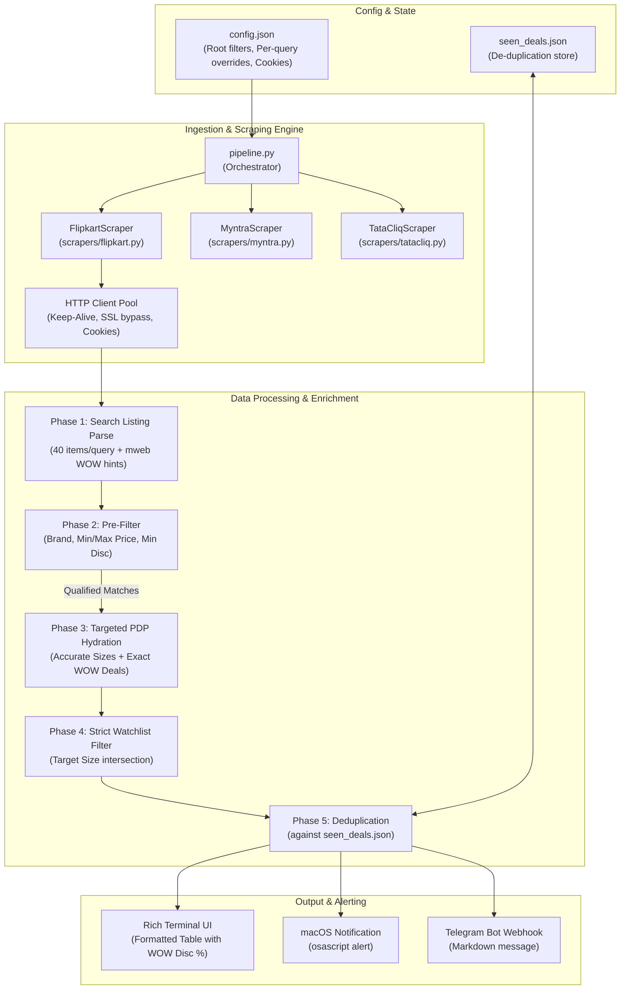
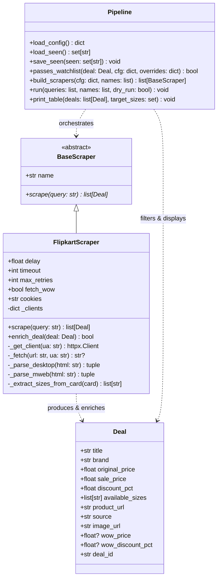
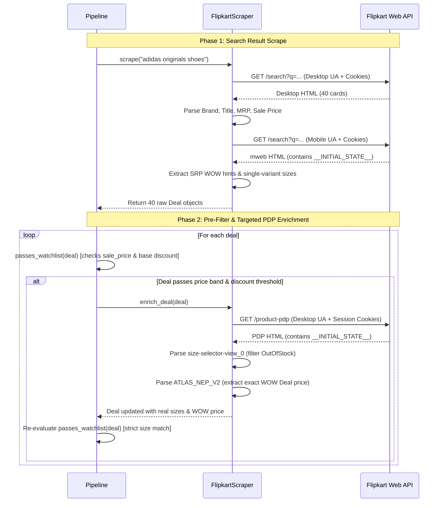
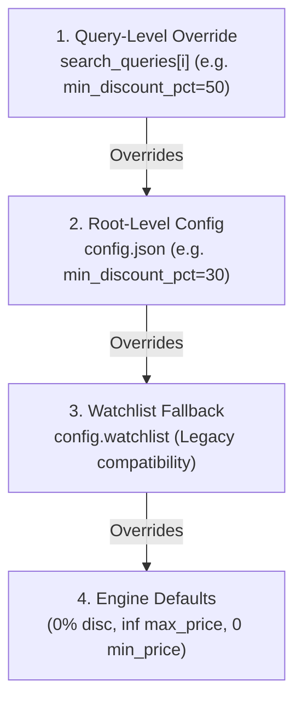

# Deal Scanner Architecture: High-Level Design (HLD) & Low-Level Design (LLD)

## 1. System Overview

A modular, highly optimized deal hunter and scanner designed to discover steep discounts on select footwear/apparel brands across Indian e-commerce platforms (Flipkart, Myntra, TataCLiQ). It solves traditional web scraper pitfalls:
1. **Dynamic pricing bypass**: Extracts authenticated VIP/Plus and bank offer discounts ("WOW Deals") embedded in SSR JSON states (`__INITIAL_STATE__`).
2. **Accurate size verification**: Hydrates in-stock variants from size-matrix widgets, filtering out phantom or out-of-stock listings.
3. **Targeted two-phase scraping**: Avoids mass PDP scraping bans by listing in bulk, filtering candidates, and enriching only qualified matches.

---

## 2. High-Level Design (HLD)

### 2.1 Architecture Diagram



### 2.2 Core Component Responsibilities

| Component | Responsibility |
| :--- | :--- |
| **`pipeline.py`** | Execution orchestrator. Handles CLI args, merges configuration overrides, executes scrapers, drives the 2-phase pipeline, renders tables, and dispatches alerts. |
| **`scrapers/base.py`** | Core domain model ([`Deal`](file:///Users/prabhashishsingh/codex/deal_scrapper/scrapers/base.py)) and abstract contract ([`BaseScraper`](file:///Users/prabhashishsingh/codex/deal_scrapper/scrapers/base.py)). |
| **`scrapers/flipkart.py`** | Dual-strategy scraper (Desktop DOM + mweb SSR JSON + PDP `multiWidgetState` parser) with connection pooling and session cookie injection. |
| **`scrapers/http_client.py`** | Client factory providing persistent HTTP/2 connection pooling, browser impersonation headers, and platform-specific SSL cert fixes. |
| **`seen_deals.json`** | Local persistent set of unique compound IDs (`{source}::{clean_url}`) ensuring users receive alerts at most once per product. |

---

## 3. Low-Level Design (LLD)

### 3.1 Domain Model & Class Diagram



### 3.2 Data Contract: `Deal` Entity

Located in [`scrapers/base.py`](file:///Users/prabhashishsingh/codex/deal_scrapper/scrapers/base.py):

```python
@dataclass
class Deal:
    title: str
    brand: str
    original_price: float           # MRP (strike-through price)
    sale_price: float               # Standard discounted selling price
    discount_pct: float             # Standard discount: (MRP - sale_price) / MRP
    available_sizes: list[str]      # Verified in-stock size tokens (e.g. ['9', '10'])
    product_url: str                # Normalized URL without tracking params
    source: str                     # "flipkart" | "myntra" | "tatacliq"
    image_url: Optional[str] = None
    wow_price: Optional[float] = None          # Effective price after auto bank/VIP offers
    wow_discount_pct: Optional[float] = None   # Discount based on wow_price vs MRP

    @property
    def deal_id(self) -> str:
        return f"{self.source}::{self.product_url}"
```

---

## 4. Scraping & Reverse-Engineering Strategies

### 4.1 Two-Phase Execution Pipeline

Flipkart search pages paginate with 40 products per desktop request, but **do not render size selectors or final bank-offer discounts in static HTML card markup**.



### 4.2 Internal State Parsing (`window.__INITIAL_STATE__`)

Flipkart uses a React/Redux SSR pipeline embedding state into `window.__INITIAL_STATE__ = { multiWidgetState: ... }`. The scraper directly decodes this JSON blob instead of running slow headless browser engines:

1. **In-Stock Size Matrix (`size-selector-view_0`)**:
   - Location: `multiWidgetState.widgetsData.slots[].slotData.widget.data.dlsData['size-selector-view_0']`
   - Path: `scrollToListData_0.value[]`
   - Attributes:
     - `tracking.contentTitle`: Size label (e.g. `"9"`, `"10"`)
     - `tracking.contentType`: Variant status (`"InStock:Variant"`, `"Scarcity:Variant"`, `"OutOfStock:Variant"`)
   - **Filter Logic**: Rejects `"OutOfStock:Variant"`. Only retains available stock.

2. **WOW Deal Pricing (`ATLAS_NEP_V2`)**:
   - Location: `multiWidgetState.widgetsData.slots[].slotData.widget.data` where `type == "ATLAS_NEP_V2"`
   - Extraction: Regex match on `collapseTitle` (e.g. `"Buy at ₹3,671"` or `"Buy at ₹6,264"`).
   - Fallback: `nepContext` JSON field (`fkap` / `fkfp`).

3. **Session Authentication & VIP/Plus Pricing**:
   - Flipkart serves custom tier pricing (Flipkart VIP, Flipkart Plus, personalized bank cards) when authenticating via request headers.
   - Injecting `"flipkart_cookies"` (containing `T=...`, `at=...`, `SN=...`) into the HTTP client headers causes the SSR renderer to emit the lower authenticated rates.

---

## 5. Configuration & Overrides Hierarchy

Configuration values resolve using hierarchical precedence:



### Evaluation Logic in `passes_watchlist`:

```python
# Priority: Query override -> Root level -> Watchlist -> Engine default
min_disc  = ovr.get("min_discount_pct", cfg.get("min_discount_pct", wl.get("min_discount_pct", 0)))
max_price = ovr.get("max_price", cfg.get("max_price", wl.get("max_price", float("inf"))))
min_price = ovr.get("min_price", cfg.get("min_price", wl.get("min_price", 0)))

# Filter criteria:
1. deal.sale_price >= min_price
2. deal.sale_price <= max_price
3. deal.discount_pct >= min_disc (evaluated on base selling price)
4. deal.brand in target_brands
5. target_sizes.intersection(deal.available_sizes) is not empty
```

---

## 6. Output & Notification Pipeline

The display engine formats all attributes into a multi-column Rich table:
- **`Sale`**: Standard discounted selling price.
- **`Disc %`**: Selling discount vs MRP.
- **`WOW`**: Final effective price after auto-applied bank/VIP discounts.
- **`WOW Disc`**: Effective total discount vs MRP using the WOW price.
- **`Sizes ✓`**: Highlighted target sizes in green, unavailable/adjacent sizes in dim grey.

New deals trigger alerts via:
1. **macOS Notification**: Native popup using `osascript -e 'display notification ...'`.
2. **Telegram Bot**: HTTP POST to `https://api.telegram.org/bot<token>/sendMessage` with Markdown-formatted payload.
