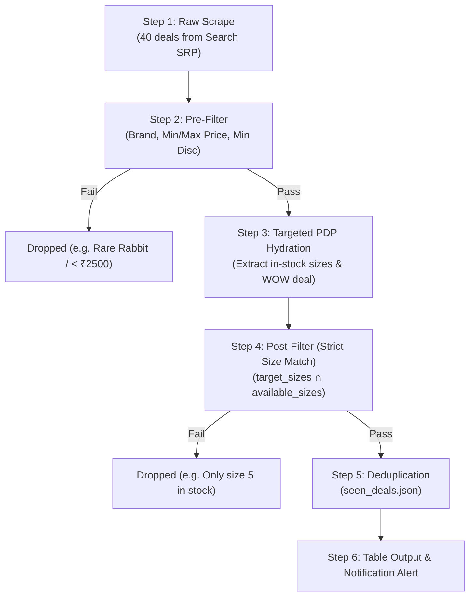

# Deal Scanner Pipeline: End-to-End Dry Run Trace

This document traces the exact data state transformations across every pipeline stage using the **active configuration**:

```json
{
  "search_queries": [
    {
      "query": "adidas originals shoes",
      "min_discount_pct": 50,
      "min_price": 2500,
      "max_price": 10000
    }
  ],
  "watchlist": {
    "brands": ["Nike", "Adidas", "Puma", "Adidas Originals", "asics"],
    "target_sizes": ["9", "10", "11", "L", "XL", "32", "34"]
  }
}
```

---

## 1. Trace Overview & Lifecycle



---

## 2. Step-by-Step Data Trace (3 Concrete Samples)

### Case A: Matched Deal (Passes All Stages)
> **Product**: `ADIDAS ORIGINALS SL 72 RS Sneakers For Men`

#### Step 1: Raw Scrape (Desktop DOM + mweb SRP)
Desktop scraper parses the product card, mobile web decodes initial price hints:
```python
Deal(
    title='ADIDAS ORIGINALS SL 72 RS Sneakers For Men',
    brand='ADIDAS ORIGINALS',
    original_price=9999.0,        # Struck-through MRP
    sale_price=4799.0,            # Selling price on search card
    discount_pct=52.0,            # round((9999 - 4799) / 9999 * 100)
    available_sizes=[],           # Not rendered in search result card
    product_url='https://www.flipkart.com/adidas-originals-sl-72-rs-sneakers-men/p/itm...split("?")[0]',
    source='flipkart',
    wow_price=None,
    wow_discount_pct=None
)
```

#### Step 2: Pre-Filter Evaluation (`passes_watchlist`)
Evaluates query override rules:
| Check | Condition | Deal Value | Verdict |
| :--- | :--- | :--- | :--- |
| **Brand** | in `watchlist.brands` | `"ADIDAS ORIGINALS"` | **PASS** |
| **Min Price** | `sale_price >= 2500` | `₹4799.0` | **PASS** |
| **Max Price** | `sale_price <= 10000` | `₹4799.0` | **PASS** |
| **Min Discount** | `discount_pct >= 50%` | `52.0%` | **PASS** |
| **Size** | `available_sizes` empty | `[]` (unknown) | **PASS (Deferred to PDP)** |
*Candidate passes pre-filter. Proceeds to targeted PDP enrichment.*

#### Step 3: Targeted PDP Hydration (`fk.enrich_deal`)
Scraper makes authenticated request to product PDP using session cookies and inspects `window.__INITIAL_STATE__`:
1. **Size Matrix** (`size-selector-view_0`):
   - Variant `4`: `"OutOfStock:Variant"` → Ignored
   - Variant `5`: `"OutOfStock:Variant"` → Ignored
   - Variants `6, 7, 8, 9, 10, 11, 12`: `"InStock:Variant"` → Added
2. **WOW Deal Price** (`ATLAS_NEP_V2`):
   - `collapseTitle`: `"Buy at ₹3,671"` (User VIP/Plus & bank discount applied)
   - Calculated WOW Discount: `round((9999 - 3671) / 9999 * 100) = 63.0%`

**Hydrated Data State**:
```python
Deal(
    title='ADIDAS ORIGINALS SL 72 RS Sneakers For Men',
    brand='ADIDAS ORIGINALS',
    original_price=9999.0,
    sale_price=4799.0,
    discount_pct=52.0,                                    # Base discount on sale price
    available_sizes=['6', '7', '8', '9', '10', '11', '12'], # Real in-stock sizes
    product_url='https://www.flipkart.com/...',
    source='flipkart',
    wow_price=3671.0,                                     # Authenticated WOW deal price
    wow_discount_pct=63.0                                 # WOW discount on MRP
)
```

#### Step 4: Strict Post-Filter (`passes_watchlist`)
Now that sizes are known:
- User Target Sizes: `{'9', '10', '11', 'L', 'XL', '32', '34'}`
- Deal In-Stock Sizes: `{'6', '7', '8', '9', '10', '11', '12'}`
- Intersection: `{'9', '10', '11'}` (Non-empty) → **PASS**

#### Step 5: Deduplication & State Update
- Checks `seen_deals.json`: `deal_id = "flipkart::https://www.flipkart.com/..."` not found in `seen`.
- Appends to `new_deals`.
- Adds `deal_id` to `seen`.

#### Step 6: Output Presentation
Rendered row in Rich terminal table:
```
Source   : Flipkart
Brand    : ADIDAS ORIGINALS
Title    : ADIDAS ORIGINALS SL 72 RS Sn…
MRP      : ₹9999
Sale     : ₹4799
Disc %   : 52%
WOW      : ₹3671
WOW Disc : 63%
Sizes ✓  : 6 7 8 [bold green]9[/] [bold green]10[/] [bold green]11[/]
URL      : https://www.flipkart.com/…
```

---

### Case B: Dropped at Pre-Filter (Brand & Price Failure)
> **Product**: `RARE RABBIT Sneakers For Men`

#### Step 1: Raw Scrape
```python
Deal(
    title='RARE RABBIT Sneakers For Men',
    brand='RARE RABBIT',
    original_price=5499.0,
    sale_price=2089.0,
    discount_pct=62.0,
    available_sizes=[],
    product_url='https://www.flipkart.com/...',
    source='flipkart'
)
```

#### Step 2: Pre-Filter Evaluation (`passes_watchlist`)
| Check | Condition | Deal Value | Verdict |
| :--- | :--- | :--- | :--- |
| **Brand** | in `watchlist.brands` | `"RARE RABBIT"` | **FAIL (Not in target brands)** |
| **Min Price** | `sale_price >= 2500` | `₹2089.0` | **FAIL (< ₹2500)** |

**Action**: Dropped immediately. No network request wasted on PDP.

---

### Case C: Dropped at Post-Filter (Size Failure After PDP)
> **Product**: `ADIDAS ORIGINALS Sneakers For Men`

#### Step 1: Raw Scrape
```python
Deal(
    title='ADIDAS ORIGINALS Sneakers For Men',
    brand='ADIDAS ORIGINALS',
    original_price=12999.0,
    sale_price=5199.0,
    discount_pct=60.0,
    available_sizes=[],
    product_url='https://www.flipkart.com/...',
    source='flipkart'
)
```

#### Step 2: Pre-Filter Evaluation
- Brand: `"ADIDAS ORIGINALS"` → PASS
- Sale Price: `₹5199.0` (in `[2500, 10000]`) → PASS
- Discount: `60.0% >= 50%` → PASS
- Sizes: Unknown → **PASS (Candidate for PDP enrichment)**

#### Step 3: Targeted PDP Hydration
PDP response shows:
- Variants 6, 7, 8, 9, 10, 11, 12 are all `"OutOfStock:Variant"`
- Variant 5 is `"InStock:Variant"`
- `available_sizes` updated to `['5']`

#### Step 4: Strict Post-Filter (`passes_watchlist`)
- Target Sizes: `{'9', '10', '11', 'L', 'XL', '32', '34'}`
- Deal In-Stock Sizes: `{'5'}`
- Intersection: `set()` (Empty) → **FAIL**

**Action**: Dropped. User does not receive alert for a product they cannot wear.

---

## 3. Summary of Filtering Rules Matrix

| Field | Source Stage | Tested Against | Behavior |
| :--- | :--- | :--- | :--- |
| **Brand** | SRP Card | `watchlist.brands` | Case-insensitive substring/equality match. |
| **`min_price`** | SRP Card | `deal.sale_price` | Drops cheap non-target items before PDP. |
| **`max_price`** | SRP Card | `deal.sale_price` | Drops budget-exceeding items before PDP. |
| **`min_discount_pct`** | SRP Card | `deal.discount_pct` | Evaluated against standard selling price. |
| **`available_sizes`** | PDP State Matrix | `watchlist.target_sizes` | Strictly drops deals if target size is not in stock. |
| **`wow_price`** | PDP State Widget | Display only | Extracted for maximum savings visibility. |
